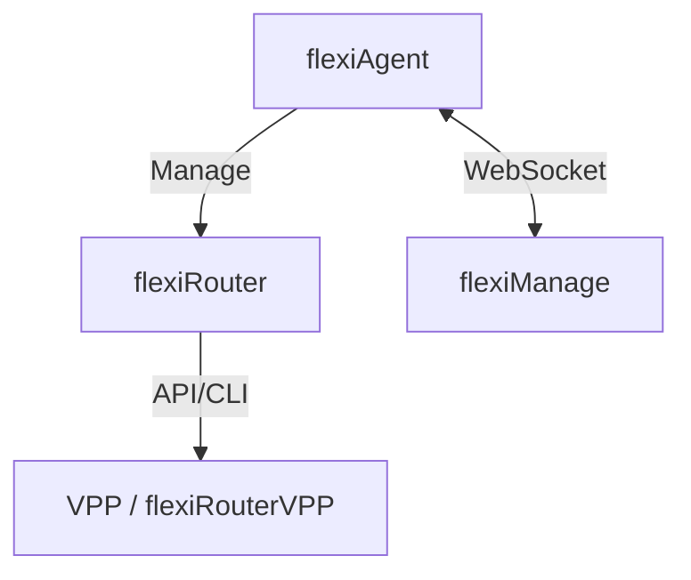

# FlexiEdge LXD カスタム拡張ガイド / FlexiEdge LXD Custom Guide

WSL2 上の LXD コンテナを使用して、flexiRouter, flexiAgent, VPP などの各コンポーネントを個別に統合・拡張するための高度な手順です。

## 1. コンポーネントの構成 / Components

将来的な拡張を見据え、以下の GitLab ソースコードを組み合わせて動作させます：
- **flexiAgent**: flexiManage との通信を担当。
- **flexiRouter / flexiRouterSB**: ルーティングロジックとサウスバウンド（SB）インターフェース。
- **flexiRouterVPP / VPP (fd.io)**: データプレーン（パケット処理）。

## 2. LXD コンテナでの開発環境構築

Ubuntu 25.10 コンテナ内で、ソースからビルドするための依存関係を解決します。

```bash
lxc launch ubuntu:25.10 edge-dev
lxc exec edge-dev -- bash

# (コンテナ内) 依存パッケージの例
apt update && apt install -y cmake build-essential python3-pip libvppinfra-dev vpp-plugin-core
```

## 3. VPP (fd.io) の利用 / Using Standard VPP

`flexiRouterVPP` の代わりに標準の VPP を利用する場合、flexiAgent/Router が VPP のバイナリAPIや統計セグメントに正しくアクセスできるよう設定します。

### VPP 設定 (`/etc/vpp/startup.conf`)
LXD 内で動かすための最小構成：
```conf
unix {
  nodaemon
  log /var/log/vpp/vpp.log
  full-coredump
  gid vpp
  interactive
}
api-segment { prefix flexiwan }
```

## 4. flexiAgent と flexiRouter の統合

GitLab から取得した各リポジトリをディレクトリ配置し、エージェントがルータープロセスを管理できるように設定ファイルを編集します。

### 構成イメージ


## 5. 将来的な拡張のヒント

- **カスタムVPPプラグイン**: fd.io VPP のプラグイン開発モデルを利用して、独自のパケット処理ロジックを LXD コンテナ上で試験できます。
- **LXD ネットワークフォワーディング**: `lxc network forward` を使用して、外部（Windows側）からのトラフィックを特定の Edge コンテナ上の VPP サービスに誘導できます。


## 6. nuitkaによるflexiAgentのコンパイル
```
sudo apt install pipx python3-dev python3-zstandard ccache patchelf
sudo pipx ensurepath --global
sudo pipx install nuitka --global
sudo pipx inject nuitka --global psutil pyro4 pyaml jwt netaddr sqlitedict pyroute2 cffi ply pycparser selectors2 jaraco.functools portend tempora cryptography asn1crypto idna cheroot pam argcomplete websocket ruamel.yaml backports.functools-lru-cache distro
nuitka --onefile --standalone --lto=yes  --follow-imports --plugin-enable=pylint-warnings --include-package=ruamel.yaml --include-data-dir=build=build --include-plugin-files=tools/system_checker/fwsystem_checker.py --include-plugin-files=tools/system_checker/fwsystem_checker_common.py --include-plugin-files=tools/common/fw_vpp_startupconf.py --include-plugin-dir=tools/stun fwagent.py

---
> [!NOTE]
> ソースコードの詳細なビルド手順については、`reference/fleximanage` 以下のドキュメントも併せて参照してください。
